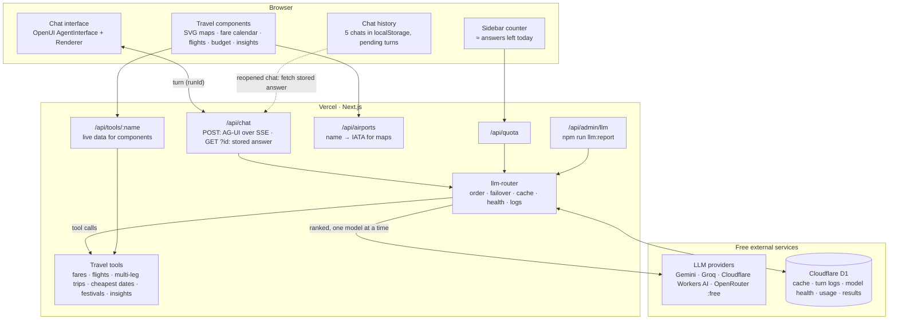
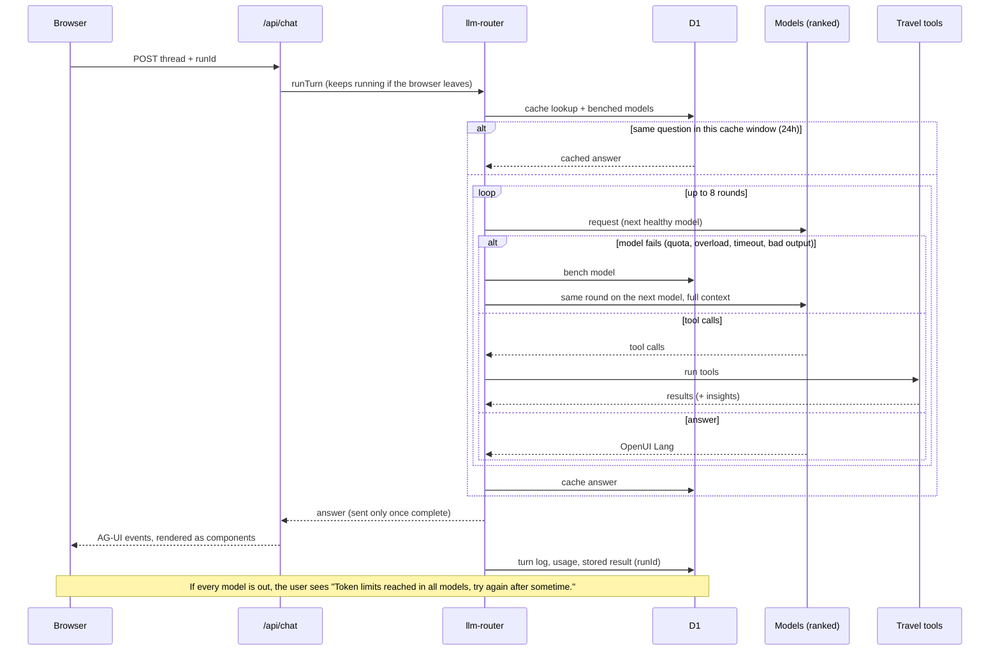

# Wayfinder: trip planning with OpenUI

Live: https://wayfinder-trips.vercel.app

A chat app for trip planning, destination discovery, flexible-date search, comparisons and
flight booking. The model answers in [OpenUI Lang](https://www.openui.com/docs/openui-lang)
and the browser renders interactive components: destination cards on a map, a fare calendar,
live flight lists, cheapest round-trip and open-jaw date pairs, multi-leg trips (round trip,
open-jaw, multi-city) with a flight picker per leg, day-by-day itineraries, an adjustable trip
budget, comparison tables, travel insights and a booking review. It knows every airport with
scheduled service (~4,000; Surat, Indore, Heathrow, Gatwick…), and every model it uses is on a
free tier.

## Architecture



### One chat turn



### How it fits together

- **The model writes the UI.** Answers are OpenUI Lang (`root = Card([...])`) built from
  OpenUI's chat components plus travel components ([src/library.ts](src/library.ts)). The
  system prompt is generated from that component library, then adds house rules and examples
  ([src/lib/prompt.ts](src/lib/prompt.ts)).
- **Components act in place.** Switching months, picking a day, sorting and filtering flights,
  selecting a flight, checkout, and adjusting a budget all happen inside the component, which
  loads data from `/api/tools/*`. Only buttons marked ✦ send a new message.
- **Any airport, no extra model call.** Tools accept a city, airport name or IATA code
  ("Surat", "Bombay", "Heathrow", "STV") and resolve it in code against
  [src/data/airports.json](src/data/airports.json), which comes from OurAirports and is public
  domain. Unknown places get suggestions. The prompt no longer lists airports.
- **Every trip shape.** `search_flights` and `FlightResults` handle one-way trips. `search_itinerary`
  and `Itinerary` handle round trip, open-jaw and multi-city trips with fixed dates: up to 6 legs,
  one flight picked per leg, then a single checkout. `find_cheapest_dates` and `TripDates` handle
  flexible round-trip and open-jaw trips: the cheapest departure/return pairs for a stay of N–M
  nights in a month. Each supports a maximum number of stops.
- **Prices never come from model text.** Fare, flight and budget components load their numbers
  themselves. The model only passes search parameters.
- **House rules** are set in three places:
  - Policy in the prompt: INR only, and 2–4 grounded insights in every answer.
  - Facts in the tools: a festivals and events calendar, plus pricing insights computed from
    the fare data. Fares rise during festivals in that data too.
  - Enforcement in code: tools default to INR.
- **Free models only, never an error.** [src/llm.config.ts](src/llm.config.ts) ranks the models:
  1. Gemini Flash
  2. Groq `gpt-oss-120b`
  3. Cloudflare `gpt-oss-120b`
  4. OpenRouter `:free` models
  5. Other Cloudflare and Groq models
  6. Gemini Flash Lite

  The reusable [llm-router](src/lib/llm-router/README.md) tries them in order. A failed model is
  benched, and shared health in D1 means every server instance skips it. The next model
  continues the same turn with the full context.
- **Cache.** A repeated conversation is answered from D1 in about 0.6 seconds, with no model call.
  The whole cache refreshes on a timer: every 24 hours by default (at 00:00 UTC, 5:30 AM IST).
  Change it with `CACHE_REFRESH_HOURS`. Editing the prompt invalidates the cache immediately.
- **Turns survive switching chats.** The server finishes every turn and stores the answer under
  its `runId`. The browser keeps the turn marked pending and fetches the answer when the chat is
  reopened.
- **Observability.** Every turn is logged to D1: outcome, cache hit, every attempt with status,
  latency and tokens, and which model answered. Run `npm run llm:report` to see the model order,
  benched models, today's usage and recent turns. `/api/quota` powers the sidebar counter: a daily budget
  (`DAILY_ANSWER_BUDGET`, default 150) minus AI answers given today, reset at 00:00 UTC.

## Files

| Path | Purpose |
| --- | --- |
| `src/app/page.tsx` | Agent Interface, starters, quota badge |
| `src/library.ts` | Component library: OpenUI chat library plus travel components |
| `src/components/travel.tsx` | `DestinationGrid/Card`, `PriceCalendar`, `FlightResults`, `FlightReview`, `TripDates`, `Itinerary`, `TripBudget`, `TripItinerary/DayPlan`, `TravelInsights` |
| `src/components/route-map.tsx` | Lightweight SVG route maps: Natural Earth outlines via d3-geo, pins and great-circle arcs |
| `src/components/quota-badge.tsx` | Sidebar counter: "≈ N answers left today" |
| `src/lib/chat-storage.ts` | Local chat history (5 chats), pending turns, AG-UI connection |
| `src/llm.config.ts` | Model order, daily allowances, prompts, cache, store |
| `src/lib/llm-router/` | Reusable router: providers, failover, cache, D1 store, AG-UI handler ([README](src/lib/llm-router/README.md)) |
| `src/lib/prompt.ts` | System prompts (full and compact), house rules, examples |
| `src/lib/tools.ts` | Tool schemas, validation, dispatch |
| `src/lib/travel-data.ts` | **Mock** fares, flights, destinations, budgets, insights |
| `src/lib/events.ts` | **Mock** festivals and events calendar (approximate dates) |
| `src/lib/airports.ts` | ~4,000 airports, name/alias resolution, suggestions (server) |
| `src/lib/airport-coords.ts`, `src/data/` | Airport dataset (OurAirports) and the light coordinates file for maps |
| `src/app/api/airports/route.ts` | Name → IATA for maps (cached, no model) |
| `src/app/api/chat/route.ts` | `POST` turn (AG-UI over SSE) and `GET ?id=` stored answer |
| `src/app/api/session/route.ts` | Anonymous guest identity and password-based admin sign-in |
| `src/app/api/chats/route.ts` | Admin's read-only archive of all chats |
| `src/app/api/tools/[name]/route.ts` | Read-only tools for the components |
| `src/app/api/quota/route.ts` | Public daily quota estimate |
| `src/app/api/admin/llm/route.ts` | Router report (needs `ADMIN_TOKEN`) |
| `src/app/api/checkout/route.ts` | **Mock** checkout (holds a seat, no payment) |
| `scripts/llm-report.mjs` | `npm run llm:report` |

## Run locally

Requires Node 22.13+.

```bash
cp .env.example .env.local   # add at least GEMINI_API_KEY; see the file for the other free providers
npm install
npm run dev
```

Open http://localhost:3000. `npm run generate` runs automatically before `dev` and `build`. It
writes `src/generated/spec.json` from the component library, and the server builds the prompt
from that file. Local development logs to a separate namespace (`wayfinder-dev`) in the same
store.

## Deploy

Hosted on Vercel (project `wayfinder-trips`). Secrets are sensitive production environment
variables there: provider keys, `CLOUDFLARE_ACCOUNT_ID`, `CLOUDFLARE_API_TOKEN`, `D1_DATABASE_ID`
and `ADMIN_TOKEN` (for the router report). Admin chat sign-in also requires `ADMIN_PASSWORD`
and an independent, random `SESSION_SECRET` of at least 32 characters. The guest ID is assigned
automatically with a signed cookie; guests do not need to enter anything. Admin sign-in uses the
password, and archived chats open read-only from the sidebar.

```bash
npx vercel deploy --prod
```

Free capacity is roughly 150 fresh AI answers per day across all providers, and cached answers
don't count toward it. The sidebar counter shows a simple estimate (`DAILY_ANSWER_BUDGET`).

## Going to production

1. Replace the mock data in `src/lib/travel-data.ts` and `src/lib/events.ts` with real
   providers, such as Duffel or Amadeus for flights and an events API for festivals. Keep the
   same return shapes.
2. Replace `/api/checkout` with the provider's order/hold API and a payment step.
3. Add authentication and rate limiting to `/api/chat` and `/api/tools/*`.
4. For more AI capacity, enable billing on one provider (for example Gemini) and raise its
   `dailyRequests` in `src/llm.config.ts`.
